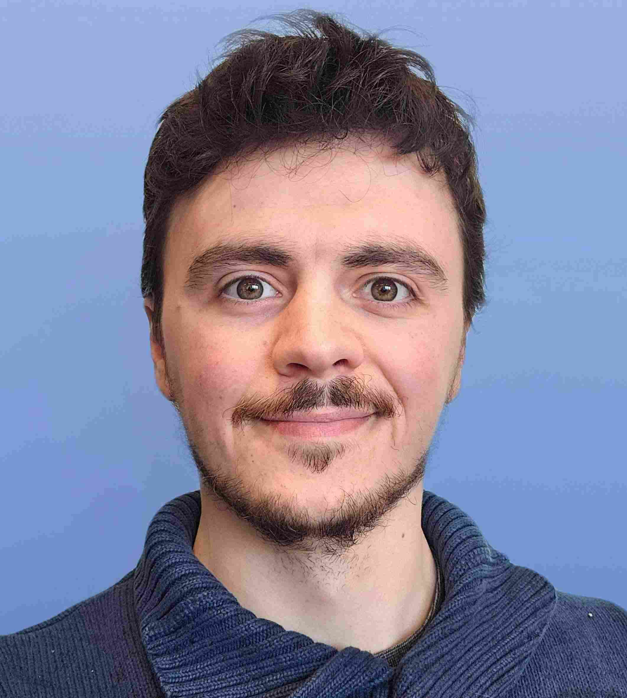

  

## Biography
Youri is a young marine ecology modeler. Originally trained as a computer scientist, he found himself captivated by the wonderful world of marine ecology during his end-of-study internship at IFREMER. After a year of volunteering at RBINS in 2024, he finally officially joined the ECOMOD team as a modeler on the [CAFEINE](/projects/CAFEINE/) project. Under the supervision of [Nathan Terseleer](/posts/members/NTL/), he develops a numerical framework coupling biogeochemistry, mineral flocculation and suspension feeder ecology, from 0D to 3D. His work aims to quantify how suspension feeders on man-made structures, such as offshore wind farms, alter flocculation processes and redirect primary production toward benthic pathways across coastal-offshore gradients.

### Experience
- **Royal Belgian Institute of Natural Sciences** | Brussels, Belgium 
  Scientific collaborator | 2026-Current
- **Centran** | Mont-Saint-Guibert, Belgium 
  Software Developer | 2025-2026
- **Royal Belgian Institute of Natural Sciences** | Brussels, Belgium 
  Scientific collaborator | 2024-2025

### Education
- **ULB** | Université Libre de Bruxelles, Brussels, Belgium 
  MSc Bioinformatic and modelling | 2020-2024 
- **HE2B ESI** | Haute École Bruxelles-Brabant (école supérieur d'informatique), Brussels, Belgium 
  BSc computer sciences | 2017-2020 

## Projects
- [CAFEINE](/projects/CAFEINE/): CArbon Fate and Export In the North sEa

